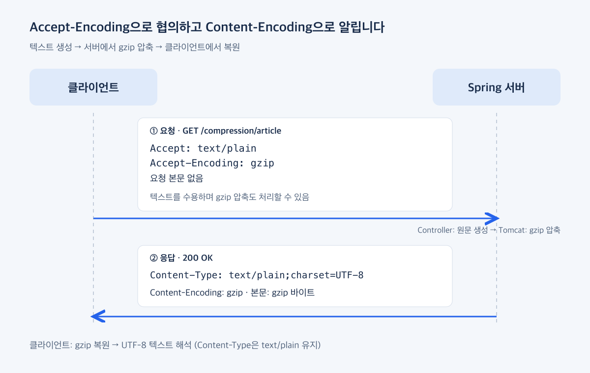

# HTTP 헤더 1편: 무엇을 보내고 어떻게 받을까?

### Preview

CS 기본기로 무엇이 필요할까? 강의로 준비한다면 어떤 내용을 설명하면 좋을까? 이런 생각을 하다가 HTTP Header를 따로 정리해봤습니다.

모질라의 [MDN HTTP 헤더 문서](https://developer.mozilla.org/ko/docs/Web/HTTP/Reference/Headers)에 들어가면 방대한 설명과 예제를 볼 수 있습니다. 개인적으로는 웬만한 책이나 아티클보다 자세하고 친절하게 정리되어 있다고 느꼈습니다. 다만 헤더 종류가 워낙 많고, 사이드바의 알파벳순 목록만으로는 해결하려는 문제에 어떤 헤더가 필요한지 바로 찾기 어려웠습니다.

`Content-Type`이나 `Authorization`처럼 개발하면서 자주 사용하는 헤더도 있지만, 설정을 알고 있는 것과 요청·응답 안에서 어떤 역할을 하는지 설명하는 것은 조금 다릅니다. 헤더의 의미를 이해하면 웹 요청을 더 세밀하게 다루고, 의도한 대로 동작하는지도 확인할 수 있습니다.

이번 글에서는 모든 헤더의 옵션을 설명하기보다, 역할을 중심으로 분류하고 핵심적인 내용을 살펴보려고 합니다. 필요할 때 관련 문서로 찾아갈 수 있는 작은 지도가 되었으면 합니다.

### HTTP Header를 왜 알아야 할까?

API를 개발하면 요청 본문과 응답 데이터에 먼저 집중하게 됩니다. JSON에 어떤 필드가 있는지, 원하는 데이터가 제대로 반환되는지부터 확인하는 것이 자연스럽습니다.

그런데 본문만 확인해서는 설명하기 어려운 문제도 있습니다.

- 서버의 데이터를 수정했는데 화면에는 이전 내용이 보입니다.
- 같은 API가 curl에서는 동작하는데 브라우저에서는 응답을 읽지 못합니다.
- 인증 정보를 보냈는데도 접근이 거절됩니다.
- 응답은 JSON인데, 네트워크에서는 압축된 데이터로 전달됩니다.

이때 헤더를 이해하고 있으면 캐시, CORS, 인증, 압축처럼 확인할 지점을 좁힐 수 있습니다. 헤더만 보고 원인을 단정할 수는 없지만, 서버 로그와 브라우저의 Network 탭에서 무엇을 함께 봐야 하는지 판단하는 데 도움이 됩니다.

헤더 처리의 일부는 프레임워크나 웹 서버의 기본 설정에 맡겨두게 됩니다. 평소에는 편리하지만, 예상과 다르게 동작하면 어디부터 확인해야 할지 막막할 수 있습니다. 특히 배포하면서 프록시나 캐시가 추가되면 로컬에서 보지 못한 문제가 드러나기도 합니다.

헤더 값에 따라 어떤 동작이 달라지는지 알고 있으면, 설정을 바꾸기 전에 요청과 응답의 흐름을 머릿속으로 그려볼 수 있습니다. 문제를 고치는 과정에서도, API를 설계하는 과정에서도 이런 이해가 차이를 만든다고 생각합니다.

### HTTP Header가 하는 일들

서버가 응답으로 JSON을 보냈다고 해보겠습니다. 본문에는 필요한 데이터가 들어 있지만, 받는 쪽에는 그 데이터를 처리할 정보도 필요합니다. 어떤 형식으로 읽어야 할지, 저장했다가 다시 써도 될지, 압축되어 있다면 어떻게 풀어야 할지 같은 것들입니다.

헤더에는 이런 정보가 담깁니다. 요청에서도 마찬가지입니다. 어떤 응답을 받을 수 있는지 알리거나, 보호된 데이터에 접근하기 위한 인증 정보를 보내는 데 사용합니다.

[MDN의 HTTP 개요](https://developer.mozilla.org/ko/docs/Web/HTTP/Guides/Overview)에서도 캐시, 출처 제약, 인증, 프록시와 터널링, 세션 등을 다룹니다. 여기서는 개발할 때 어떤 문제와 연결되는지를 기준으로 조금 다르게 묶어봤습니다.

| 역할 | 관련 헤더 |
| --- | --- |
| 데이터의 형식과 언어 선택·해석 | `Accept`, `Content-Type`, `Accept-Language` |
| 압축 방식 협의와 표시 | `Accept-Encoding`, `Content-Encoding` |
| 응답 저장·재사용·변경 확인 | `Cache-Control`, `ETag`, `If-None-Match`, `Vary` |
| 인증 정보 전달과 인증 방식 안내 | `Authorization`, `WWW-Authenticate` |
| 요청 사이의 상태 유지 | `Set-Cookie`, `Cookie` |
| 다른 출처의 응답 읽기 허용 | `Origin`, `Access-Control-Allow-Origin` 등 |
| 브라우저 보안 정책 전달 | `Content-Security-Policy` 등 |
| 이동·다운로드·부분 조회 | `Location`, `Content-Disposition`, `Range` |

이렇게 나눴지만 역할 사이에 선이 딱 그어지는 것은 아닙니다. 쿠키는 로그인 상태를 이어가는 데 쓰일 수 있고, 압축 방식이 다르면 캐시도 응답을 구분해야 합니다.

표는 필요한 헤더를 찾기 위한 출발점입니다. 캐시 때문에 이전 데이터가 보이는 것 같다면 캐시 헤더부터, 브라우저에서만 응답을 읽지 못한다면 CORS 관련 헤더부터 살펴보는 식입니다. [MDN 헤더 문서](https://developer.mozilla.org/ko/docs/Web/HTTP/Reference/Headers)를 읽을 때도 이런 질문을 가지고 찾아보려고 합니다.

먼저 자주 함께 사용하는 Accept와 Content-Type부터 보겠습니다.

### JSON으로 요청을 보내면 응답도 무조건 JSON일까?

API를 호출할 때 `Content-Type`과 `Accept`에 모두 `application/json`을 넣는 경우가 많습니다. 같은 값을 쓰다 보니 비슷한 설정처럼 보이지만, 두 헤더가 설명하는 대상은 다릅니다.

`Content-Type`은 **지금 보내는 본문이 어떤 형식인지**, 요청의 `Accept`는 **응답으로 어떤 형식을 수용할 수 있는지**를 알려줍니다.

차이를 보려면 두 값을 다르게 놓아보는 편이 쉽습니다. 글 제목은 JSON으로 보내고, 미리보기는 텍스트로 받는 요청입니다.

```http
POST /articles/preview HTTP/1.1
Host: localhost:8080
Content-Type: application/json
Accept: text/plain

{"title":"HTTP 헤더"}
```

“보내는 내용은 JSON이고, 받을 내용은 텍스트였으면 좋겠다”는 뜻입니다. 서버가 이 형식을 지원한다면 다음처럼 응답할 수 있습니다.

```http
HTTP/1.1 200 OK
Content-Type: text/plain;charset=UTF-8

Preview: HTTP 헤더
```

응답에도 `Content-Type`이 있습니다. 이번에는 서버가 보낸 본문을 설명하므로 값이 `text/plain`입니다. `charset=UTF-8`은 텍스트를 해석할 문자 인코딩입니다. 요청과 응답의 Content-Type이 같아야 할 이유는 없습니다. 위 메시지는 일부 헤더를 생략한 설명용 예시입니다.


#### 실제 표현 선택 다뤄보기

Spring에서는 컨트롤러의 매핑 어노테이션에서 `consumes`로 받을 요청 형식을, `produces`로 제공할 응답 형식을 지정할 수 있습니다.

```java
@PostMapping(value = "/articles/preview", consumes = "application/json", produces = "text/plain;charset=UTF-8")
```

위 설정은 JSON 요청을 받아 텍스트 응답을 제공하는 메서드의 매핑 조건입니다. 예제에서는 같은 URL에 JSON·텍스트·SVG 이미지 응답을 준비하고 `Accept`에 따라 선택하도록 했습니다.

다만 헤더를 바꾼다고 본문까지 자동으로 바뀌는 것은 아닙니다. `Content-Type: application/json`이라고 선언했다면 본문도 실제 JSON이어야 하고, 서버가 JSON 응답을 제공하려면 그 응답을 만드는 처리도 있어야 합니다. Spring에서는 메시지 컨버터가 본문을 읽고 쓰는 변환을 담당합니다.

`Accept: image/svg+xml`을 보내면 글 제목이 들어간 이미지를 받을 수도 있습니다. 서버 실행 후 `/preview.html`에서 세 표현을 비교할 수 있습니다.

이번 예제는 `@RestController`로 반환값을 응답 본문에 쓰는 방식입니다. HTML 템플릿을 렌더링하는 MVC 방식과는 구분해야 합니다. `@Controller`를 붙이는 것만으로 응답 형식이 HTML로 결정되지는 않습니다. [Spring 반환값 처리](https://docs.spring.io/spring-framework/reference/web/webmvc/mvc-controller/ann-methods/return-types.html)

전체 Controller와 실행 명령은 [GitHub 예제](https://github.com/inspire12/blog-article-example/tree/main/examples/http-headers-spring)에 정리했습니다. JSON·텍스트 응답뿐 아니라 요청 형식이 맞지 않는 경우, 지원하지 않는 응답 형식을 요구하는 경우도 테스트에서 확인할 수 있습니다.

요청 본문을 읽지 못한다면 먼저 Content-Type과 실제 본문을, 원하는 응답을 받지 못한다면 Accept와 서버가 지원하는 형식을 함께 확인하면 됩니다.

참고: [MDN Accept](https://developer.mozilla.org/en-US/docs/Web/HTTP/Reference/Headers/Accept) · [MDN Content-Type](https://developer.mozilla.org/en-US/docs/Web/HTTP/Reference/Headers/Content-Type) · [Spring 요청 매핑](https://docs.spring.io/spring-framework/reference/web/webmvc/mvc-controller/ann-requestmapping.html)

### 같은 응답을 더 적은 데이터로 보낼 수 있을까?

글 목록 API가 제목과 본문 수십 개를 반환한다고 해보겠습니다. 요청은 짧지만 응답은 꽤 커질 수 있습니다. 데이터가 커질수록 내려받아야 할 양도 늘어납니다.

이때 본문을 압축해서 보내면 전송량을 줄일 수 있습니다. 서버가 압축한 데이터를 보내고, 클라이언트가 풀어서 원래 내용을 사용하는 방식입니다. 여기서는 응답 본문에 gzip을 적용하는 과정을 살펴보겠습니다.

### 클라이언트와 서버가 같은 압축 방식을 지원해야 한다

서버가 압축해 보내더라도 클라이언트가 풀 수 없다면 사용할 수 없습니다. 그래서 클라이언트는 요청에 처리할 수 있는 방식을 적습니다.

```http
Accept-Encoding: gzip, br
```

이 요청은 gzip과 Brotli로 압축한 응답을 처리할 수 있다는 뜻입니다. 둘을 차례대로 적용하라는 뜻은 아닙니다. 서버가 지원하는 방식과 설정을 보고 사용할 방식을 선택합니다. 요청에 `br`가 있다고 서버에 Brotli 기능이 생기는 것은 아닙니다.

서버가 gzip을 적용했다면 응답에는 다음 헤더가 붙습니다.

```http
Content-Encoding: gzip
```

`Accept-Encoding`은 받을 수 있는 방식이고, `Content-Encoding`은 실제로 적용한 방식입니다. 클라이언트가 gzip을 지원해도 서버는 조건에 따라 압축하지 않을 수 있습니다. [MDN Accept-Encoding](https://developer.mozilla.org/en-US/docs/Web/HTTP/Reference/Headers/Accept-Encoding)

예제의 요청과 응답을 연결하면 다음과 같습니다. 일부 헤더는 생략했습니다.

```http
GET /compression/article HTTP/1.1
Host: localhost:8080
Accept-Encoding: gzip
```

```http
HTTP/1.1 200 OK
Content-Type: text/plain;charset=UTF-8
Content-Encoding: gzip
Vary: Accept-Encoding

[gzip으로 압축된 본문 바이트]
```

클라이언트는 gzip을 풀고 나서 본문을 읽습니다. 압축을 풀면 텍스트이므로 Content-Type은 여전히 `text/plain`입니다.

여기서 `Content-Encoding`은 압축을 실행하는 명령이 아닙니다. 실제 본문은 그대로 두고 이 헤더만 붙이면 클라이언트는 일반 텍스트를 gzip으로 풀려고 하다가 오류를 만날 수 있습니다. [MDN Content-Encoding](https://developer.mozilla.org/en-US/docs/Web/HTTP/Reference/Headers/Content-Encoding)



#### 실제 압축 다뤄보기

Spring Boot에서는 내장 웹 서버의 응답 압축 기능을 켤 수 있습니다. 이번 예제는 내장 Tomcat을 사용하고, 다음처럼 설정했습니다.

```properties
server.compression.enabled=true
server.compression.mime-types=application/json,text/plain
server.compression.min-response-size=1KB
```

압축을 활성화하고 대상 타입과 최소 응답 크기를 지정한 것입니다. Controller는 평소처럼 문자열을 반환합니다. Tomcat이 요청의 Accept-Encoding과 응답 조건을 확인하고, 압축할 수 있으면 실제 본문을 압축하고 Content-Encoding도 붙입니다.

따라서 Controller에 gzip 코드를 넣거나 Content-Encoding을 직접 설정하지 않았습니다. 대상 타입과 크기를 설정해 두면 모든 응답을 무조건 압축하는 것도 피할 수 있습니다. 응답 길이를 미리 알 수 있는지 등 세부 조건은 내장 서버 구현의 영향을 받습니다. [Spring Boot 응답 압축 안내](https://docs.spring.io/spring-boot/how-to/webserver.html#howto.webserver.enable-response-compression)

### 압축은 항상 이득일까?

반복되는 필드 이름과 문자열이 많은 JSON이나 HTML은 압축 효과를 기대할 수 있습니다. 반면 JPEG나 ZIP처럼 이미 압축된 데이터는 다시 압축해도 크기가 별로 줄지 않거나 오히려 커질 수 있습니다. [MDN Content-Encoding](https://developer.mozilla.org/en-US/docs/Web/HTTP/Reference/Headers/Content-Encoding)

작은 응답도 압축으로 아끼는 양이 적을 수 있습니다. 서버에서 압축하고 클라이언트에서 복원하는 데에는 처리 비용이 들기 때문에, 압축률만으로 효과를 판단하기는 어렵습니다. 전송량이 줄었는지와 함께 서버 CPU 사용량과 실제 응답 시간도 봐야 합니다.

예제에서는 같은 문장을 200번 반복했습니다. 압축 전 본문은 13,800바이트였고 gzip으로 받은 본문은 167바이트였습니다. 반복이 많은 데이터라 잘 압축되는 조건입니다. 일반적인 API에서도 이 정도로 줄어든다는 뜻은 아닙니다.

이 측정은 본문 크기만 비교한 것입니다. DB 조회나 JSON 생성 시간을 측정하지 않았고, 응답 시간이 같은 비율로 줄었다고 볼 수도 없습니다.

### 압축했는데 Network 탭에는 왜 글자가 그대로 보일까?

브라우저는 보통 응답을 자동으로 풀어서 보여줍니다. Response 탭에 읽을 수 있는 텍스트가 나온다고 압축하지 않은 것은 아닙니다. 응답 헤더의 `Content-Encoding`을 먼저 확인하고, 전송 크기와 압축을 푼 뒤의 크기도 구분해서 봐야 합니다.

curl에서도 비슷합니다.

```bash
curl --compressed http://localhost:8080/compression/article
```

이 명령은 curl이 지원하는 압축을 요청하고 받은 본문을 자동으로 풉니다. 따라서 출력된 텍스트를 저장한 뒤 그 파일 크기를 재면 압축된 전송 크기가 아닙니다.

실제 압축 여부를 확인하려면 자동 복원 없이 gzip 바이트를 저장하고, 압축을 푼 내용이 원문과 같은지 비교하면 됩니다. 예제 테스트에서도 압축하지 않은 응답과 gzip 응답을 각각 받은 뒤 복원한 바이트가 같은지 확인했습니다. 자세한 명령과 테스트는 [GitHub 예제](https://github.com/inspire12/blog-article-example/tree/main/examples/http-headers-spring)에 정리했습니다.

압축되지 않았다면 요청의 Accept-Encoding, 서버의 압축 활성화 여부, 대상 타입과 크기 조건부터 확인하면 됩니다.

마지막으로 응답의 `Vary: Accept-Encoding`은 캐시가 압축 조건에 맞는 응답을 선택하도록 알립니다. 같은 URL에서도 압축된 응답과 압축되지 않은 응답이 나올 수 있기 때문입니다. 이 부분은 다음 편에서 캐시와 함께 살펴보겠습니다.

### 마무리

이번에 살펴본 헤더는 서로 짝을 지어 읽으면 이해하기 편합니다. Accept로 수용할 응답 형식을 알리고, 응답의 Content-Type으로 실제 형식을 확인합니다. Accept-Encoding으로 처리할 수 있는 인코딩을 알리고, Content-Encoding으로 서버가 적용한 방식을 확인합니다.

여기에 실제 본문까지 함께 보면 설정과 동작을 연결할 수 있습니다. JSON이라고 선언한 본문이 JSON인지, gzip이라고 표시한 응답이 실제로 압축되어 있는지 확인하는 것입니다.

정리하다 보니 한 글에 담기에는 내용이 많아, 이번 글을 포함해 세 편으로 나누어 이어가려고 합니다.

- **1편 — HTTP 헤더의 필요성, 표현 선택·해석, 압축:** 주고받을 형식을 선택하고, 응답을 압축해 전송량을 줄이는 과정을 살펴봅니다.
- **2편 — 캐시·재검증, 인증, 상태 유지:** 받은 응답을 다시 사용하는 방법과 사용자를 확인하고 요청 사이의 상태를 이어가는 과정을 다룹니다.
- **3편 — 다른 출처의 응답 읽기, 브라우저 보안 정책, 이동·다운로드·부분 조회:** 브라우저에서만 요청이 실패하거나, 파일을 다운로드하고 이어받는 상황처럼 실제 사례를 중심으로 살펴봅니다.

다음 편은 “서버에서는 수정했는데 왜 화면에는 예전 데이터가 보일까?”라는 질문에서 시작해보려고 합니다.

캐시를 공부하다 보니 이름만 보고 이해했던 것과 다른 부분도 있었습니다. `no-cache`인데 응답을 저장할 수 있고, `ETag`로 변경 여부를 확인하더라도 DB 조회는 여전히 필요할 수 있습니다. 그렇다면 캐시는 정확히 어떤 비용을 줄여주는 걸까요?

다음 글에서는 이 질문을 요청과 응답으로 따라가 보고, 인증과 쿠키를 통해 서로 독립적인 요청들이 어떻게 로그인 상태를 이어가는지도 살펴보겠습니다.
