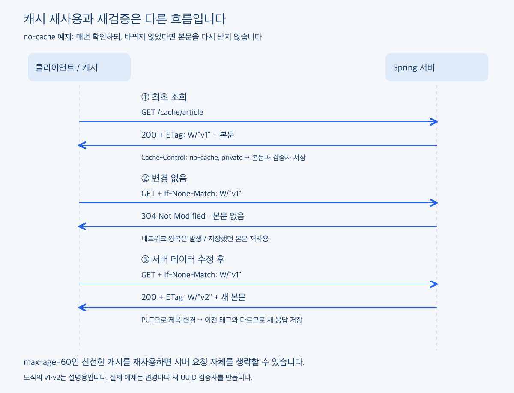
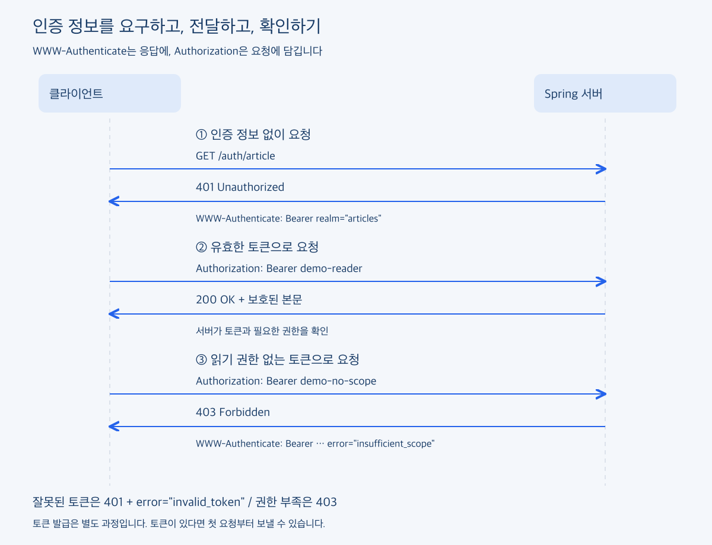

# HTTP 헤더 2편: 저장한 응답을 다시 써도 될까?

### Preview

[1편](BLOG-01-header-roles.md)에서는 HTTP 헤더의 역할을 나누고, 표현 선택과 압축을 살펴봤습니다. `Accept`와 `Content-Type`으로 어떤 형식의 데이터를 주고받는지, `Accept-Encoding`과 `Content-Encoding`으로 어떤 압축 방식을 사용할 수 있고 실제로 사용했는지 확인했습니다.

응답을 받고 나면 다음 질문이 남습니다. 같은 데이터가 다시 필요할 때 매번 서버에서 받아야 할까요? 로그인한 사용자에게만 보여줄 데이터라면 서버는 누구의 요청인지 어떻게 확인할까요?

이번 편에서는 받은 응답을 다시 사용하는 방법부터 시작해, 인증 정보를 보내고 요청 사이의 상태를 이어가는 과정까지 살펴보겠습니다.

| 역할 | 함께 볼 핵심 헤더 |
| --- | --- |
| 캐시·재검증 | `Cache-Control`, `ETag`, `If-None-Match`, `Last-Modified`, `If-Modified-Since`, `Vary` |
| 인증 | `Authorization`, `WWW-Authenticate` |
| 상태 유지 | `Set-Cookie`, `Cookie` |

먼저 캐시입니다. 서버에서는 데이터를 수정했는데 화면에는 예전 내용이 보인다면, 서버의 응답뿐 아니라 브라우저가 저장한 응답을 다시 사용하고 있는지도 확인해야 합니다. 이 동작을 이해하려면 어떤 응답을 저장하고 언제까지 다시 써도 되는지부터 정해야 합니다.

### 어떤 기준으로 캐시를 사용해야 할까?

같은 응답을 저장했다가 다시 사용하면 매번 데이터를 받아오지 않아도 됩니다. 다만 데이터마다 이전 내용을 보여줘도 되는 시간이 다릅니다.

블로그 글 목록은 잠깐 갱신이 늦어도 괜찮을 수 있지만, 주문 직전에 확인하는 재고는 같은 기준을 적용하기 어렵습니다. 데이터가 얼마나 자주 바뀌는지도 중요하지만, **사용자에게 얼마 동안 이전 내용을 보여줘도 되는지**를 먼저 생각해보면 캐시 정책을 정하기가 수월합니다.

누가 사용하는 응답인지도 함께 봐야 합니다. 누구에게나 같은 내용인지, 로그인한 사용자마다 다른 내용인지에 따라 저장을 허용할 캐시의 범위가 달라집니다. 저장 자체를 허용해도 되는 응답인지도 판단해야 합니다.

결국 캐시 정책을 정할 때는 **저장해도 되는지, 어디에 저장할 수 있는지, 언제까지 서버에 확인하지 않고 재사용해도 되는지**를 함께 살펴봐야 합니다.

서버는 `Cache-Control`로 이런 정책을 알려줄 수 있습니다. 개인 캐시에 저장하되 60초 동안은 서버에 확인하지 않고 재사용해도 되는 응답이라면 다음처럼 설정할 수 있습니다.

```http
Cache-Control: private, max-age=60, must-revalidate
```

이 설정에서는 브라우저 같은 개인 캐시에 응답을 저장할 수 있고, 응답의 나이가 60초 미만이면 신선한 것으로 취급합니다. 신선도가 지나면 성공적으로 재검증한 뒤 재사용해야 합니다.

일반적인 캐시 사용 요청이라면 신선한 응답을 서버에 묻지 않고 다시 사용할 수 있습니다. 이 경우에는 네트워크 요청 자체가 없으므로 서버의 조회 작업도 발생하지 않습니다. 서버에서 데이터를 수정하더라도 브라우저가 즉시 알아채는 것은 아닙니다.

여기서 60초는 주기적으로 데이터를 가져오라는 뜻이 아닙니다. 다음 요청에서 저장된 응답을 재사용할 수 있는지 판단하는 기준입니다. 새로고침이나 캐시 우회 요청은 동작이 달라질 수 있습니다. [MDN HTTP 캐시](https://developer.mozilla.org/en-US/docs/Web/HTTP/Guides/Caching)

### no-cache인데 저장할 수 있다고?

이름만 보면 `no-cache`는 저장하지 말라는 의미처럼 보입니다. 하지만 응답을 저장할 수 있고, 다시 사용하기 전에 유효한지 확인하도록 요구하는 설정입니다.

```http
Cache-Control: no-cache
```

저장 자체를 하지 않도록 하려면 `no-store`를 사용합니다. 여기서는 두 설정의 차이를 알고 넘어가면 됩니다. 앞으로 요청마다 변경 여부를 확인하는 예제를 만들 것이므로 `no-cache`를 사용하겠습니다.

### 바뀌지 않았다면 본문은 다시 보내지 않아도 된다

서버가 처음 응답할 때 현재 표현의 검증자인 `ETag`를 함께 보내줬다고 해보겠습니다.

ETag의 값은 서버가 정합니다. HTTP에서 생성 방법까지 정해두지는 않아서, 응답 내용의 해시나 데이터 버전 등을 사용할 수 있습니다. 중요한 것은 **응답 내용이 달라졌을 때 이를 구분할 수 있도록 태그도 갱신해야 한다는 점**입니다. 내용이 바뀌었는데 이전 태그를 그대로 사용하면 클라이언트가 예전 본문을 계속 사용하게 될 수 있습니다.

```http
HTTP/1.1 200 OK
Content-Type: application/json
Cache-Control: no-cache, private
ETag: W/"v1"

{"title":"HTTP 헤더"}
```

브라우저는 태그의 의미를 해석하지 않습니다. 본문과 태그를 저장해 두었다가, 다음 요청에 받은 태그를 그대로 보냅니다.

```http
GET /cache/article HTTP/1.1
Host: localhost:8080
If-None-Match: W/"v1"
```

“내가 가지고 있는 태그는 이것인데, 다른 내용으로 바뀌었다면 보내줘”라는 조건입니다. 서버의 현재 표현이 그대로라면 다음처럼 응답할 수 있습니다.

```http
HTTP/1.1 304 Not Modified
Cache-Control: no-cache, private
ETag: W/"v1"
```

304에는 본문이 없습니다. 클라이언트는 저장된 본문을 다시 사용합니다. 반대로 내용이 바뀌었다면 서버는 새 태그와 본문을 담아 200으로 응답합니다.

여기서 신선한 캐시를 바로 쓰는 경우와 차이가 드러납니다. **재검증은 서버와 통신합니다. 대신 바뀌지 않은 본문을 다시 전송하지 않아도 됩니다.**

`W/`는 약한 검증자라는 표시입니다. 이 예제는 전송 바이트가 완전히 같은지보다 데이터의 같은 버전인지를 나타내는 데 사용합니다. 위 태그와 메시지는 흐름을 설명하기 위해 단순화했습니다.

실제 예제에서는 데이터를 수정할 때 새 UUID로 태그를 만들어 데이터와 함께 보관합니다. 조회할 때마다 새로 만드는 것은 아닙니다. 내용이 그대로인데 매번 태그가 달라지면 서버가 계속 새 본문을 보내게 되어 재검증의 이점을 얻기 어렵기 때문입니다.



#### 실제 캐시·재검증 다뤄보기

Spring MVC에서는 ResponseEntity에 캐시 정책과 ETag를 지정할 수 있습니다.

```java
return ResponseEntity.ok().cacheControl(policy).eTag(tag).body(article);
```

Spring은 GET 요청의 조건부 헤더를 평가해, 태그가 일치하면 본문 없이 304로 응답할 수 있습니다. 문자열을 직접 비교하는 대신 프레임워크의 조건부 요청 처리를 사용했습니다. [Spring HTTP 캐시](https://docs.spring.io/spring-framework/reference/web/webmvc/mvc-caching.html)

[GitHub 예제](https://github.com/inspire12/blog-article-example/tree/main/examples/http-headers-spring)에는 메모리에 저장한 글 하나를 조회하고 수정하는 API를 추가했습니다. 처음 조회하면 200, 받은 태그로 다시 요청하면 304, 제목을 수정하고 이전 태그로 요청하면 새 본문과 함께 200을 받는 흐름입니다.

`/cache/article`은 매번 재검증하는 정책, `/cache/article/fresh`는 60초 신선도를 주는 정책입니다. 두 경로는 별개의 캐시 항목이므로 수정했다고 다른 URL의 브라우저 캐시까지 즉시 없어지지는 않습니다. 서버를 재시작하면 데이터가 초기화되는 학습용 예제입니다.

### ETag를 비교해도 결국 DB 조회는 해야 하지 않을까?

캐시를 공부하면서 궁금했던 부분입니다. 서버가 변경 여부를 알아야 한다면, 결국 데이터를 조회해야 하는 것 아닐까요?

맞습니다. ETag가 조회 비용까지 자동으로 없애주는 것은 아닙니다. DB에서 데이터를 읽고 JSON을 만든 뒤 해시를 계산한다면, 304를 보내더라도 그 앞의 작업은 이미 수행한 것입니다.

이번 예제도 메모리의 현재 데이터를 읽은 뒤 ResponseEntity를 만듭니다. Spring의 조건부 처리는 그 뒤에 일어납니다. DB 조회를 줄였다고 설명할 수 있는 예제는 아닙니다.

변경 버전만 저렴하게 확인할 수 있거나, 서버 측 캐시에서 검증자와 본문을 가져올 수 있다면 작업을 줄일 여지는 있습니다. 다만 버전 관리나 캐시 갱신까지 함께 설계해야 합니다. ETag는 그 결과를 클라이언트와 비교하는 기준입니다.

### 수정 시각과 응답 종류도 함께 볼 수 있다

변경을 확인하는 방법으로는 `Last-Modified`와 `If-Modified-Since`도 있습니다. 태그 대신 마지막 수정 시각을 비교합니다. HTTP 날짜는 초 단위이므로 짧은 간격의 변경을 구분하기 어렵다는 차이가 있습니다. 두 조건이 함께 오면 If-None-Match가 우선합니다. [MDN If-Modified-Since](https://developer.mozilla.org/en-US/docs/Web/HTTP/Reference/Headers/If-Modified-Since)

1편에서 잠깐 봤던 `Vary`는 또 다른 질문을 담당합니다. 같은 URL이라도 요청의 Accept-Encoding에 따라 압축 응답이 달라진다면, 캐시는 어떤 응답을 골라야 할까요?

```http
Vary: Accept-Encoding
```

이 헤더는 응답을 재사용할 때 요청의 인코딩 조건도 고려하도록 알립니다. Cache-Control은 재사용 정책, ETag는 변경 여부의 검증자, Vary는 저장된 응답의 선택 기준으로 구분해서 보면 됩니다. [MDN Vary](https://developer.mozilla.org/en-US/docs/Web/HTTP/Reference/Headers/Vary)

응답을 저장할 수 있는지 판단할 때는 내용이 누구에게 속하는지도 중요합니다. 로그인한 사용자마다 다른 데이터라면 다른 사람에게 같은 응답을 돌려줘서는 안 됩니다. 다음 절에서는 서버가 요청한 사용자를 어떻게 확인하는지, Authorization과 WWW-Authenticate부터 살펴보겠습니다.

### 인증 정보를 보냈는데 왜 거절될까?

앞에서는 저장된 응답을 다시 사용해도 되는지 살펴봤습니다. 이번에는 그 응답을 요청한 클라이언트에게 보여줘도 되는지 확인해보겠습니다.

공개된 글은 누구나 읽을 수 있지만, 작성 중인 글이나 내 정보는 접근을 제한해야 합니다. 서버는 요청에 담긴 인증 정보를 검증하고, 해당 작업을 허용할지도 판단해야 합니다.

이때 함께 볼 헤더가 `Authorization`과 `WWW-Authenticate`입니다.

| 헤더 | 방향 | 역할 |
| --- | --- | --- |
| `Authorization` | 요청 | 클라이언트가 인증 정보를 전달 |
| `WWW-Authenticate` | 응답 | 서버가 요구하는 인증 방식과 필요한 정보 안내 |

먼저 인증 정보 없이 보호된 글을 요청했다고 해보겠습니다.

```http
GET /auth/article HTTP/1.1
Host: localhost:8080
```

서버는 다음처럼 응답할 수 있습니다.

```http
HTTP/1.1 401 Unauthorized
WWW-Authenticate: Bearer realm="articles"
Cache-Control: no-store
```

401로 인증이 필요하다는 사실을 알리고, `WWW-Authenticate`로 어떤 방식을 요구하는지 안내합니다. 여기서는 Bearer 토큰을 요구합니다. `realm`은 보호 영역을 구분하는 이름이며 로그인 URL은 아닙니다. [MDN HTTP 인증](https://developer.mozilla.org/en-US/docs/Web/HTTP/Guides/Authentication)

### Authorization에 토큰을 넣으면 끝일까?

클라이언트가 사용할 수 있는 토큰을 가지고 있다면 요청에 담아 보냅니다.

```http
GET /auth/article HTTP/1.1
Host: localhost:8080
Authorization: Bearer demo-reader
```

서버가 토큰을 유효한 것으로 확인하고 읽기 권한도 허용하면 본문을 반환합니다.

```http
HTTP/1.1 200 OK
Content-Type: application/json
Cache-Control: no-store

{"title":"인증된 요청으로 읽는 글"}
```

헤더에 토큰이 있다는 사실만으로 접근을 허용하는 것은 아닙니다. 서버에서 유효성과 권한을 확인해야 합니다. 실제 서비스에서는 토큰 방식에 따라 서명·만료·발급 대상 등을 검증하거나 인증 서버에 조회합니다.

`WWW-Authenticate`가 토큰을 발급해 주는 것도 아닙니다. 로그인이나 토큰 발급은 별도 과정입니다. 이미 토큰이 있다면 첫 요청부터 Authorization에 넣을 수 있으므로 반드시 401을 먼저 받아야 하는 것은 아닙니다.

Bearer는 토큰을 전달하는 인증 방식이지 JWT라는 뜻은 아닙니다. 토큰 형식은 별개이며, 가진 사람이 사용할 수 있으므로 실제 서비스에서는 HTTPS로 보호해야 합니다. 아래 고정 토큰은 로컬 학습용입니다. [RFC 6750](https://datatracker.ietf.org/doc/html/rfc6750)



#### 실제 인증 헤더 다뤄보기

예제에서는 인증 정보가 없을 때 다음 응답을 반환하도록 했습니다.

```java
return ResponseEntity.status(401)
        .header(HttpHeaders.WWW_AUTHENTICATE, "Bearer realm=\"articles\"")
        .cacheControl(CacheControl.noStore()).build();
```

[Spring 예제](https://github.com/inspire12/blog-article-example/blob/main/examples/http-headers-spring/src/main/java/com/example/headers/AuthController.java)는 공개된 고정 토큰으로 네 가지 응답을 비교합니다. 토큰이 없거나 잘못되면 401, `demo-reader`면 200, 유효하지만 읽기 권한이 없는 것으로 정한 `demo-no-scope`면 403입니다.

이번 코드는 헤더 흐름을 보기 위한 Spring MVC 예제입니다. 토큰 발급·만료·실제 사용자 검증은 구현하지 않았습니다. 운영용 인증은 컨트롤러마다 이런 비교를 넣기보다 Spring Security 같은 인증 계층에서 처리하도록 구성해야 합니다. 전체 코드와 실행 명령은 GitHub에 두었습니다.

### 401과 403은 무엇이 다를까?

토큰을 보냈는데도 거절됐다면 인증 정보 자체가 유효하지 않은지, 필요한 권한이 없는지를 나눠 확인해야 합니다.

잘못되었거나 만료된 Bearer 토큰이라면 다음과 같은 응답을 받을 수 있습니다.

```http
HTTP/1.1 401 Unauthorized
WWW-Authenticate: Bearer realm="articles", error="invalid_token"
```

반면 토큰은 유효하지만 이 작업에 필요한 권한이 부족하다면 403으로 응답할 수 있습니다.

```http
HTTP/1.1 403 Forbidden
WWW-Authenticate: Bearer realm="articles", error="insufficient_scope", scope="articles:read"
```

이 예제에서 401은 유효한 인증 정보가 필요한 경우, 403은 인증 정보를 확인했지만 읽기 권한이 부족한 경우입니다. 같은 토큰으로 요청만 반복해서는 권한 문제가 해결되지 않습니다. 모든 403이 토큰 권한 문제라는 뜻은 아니지만, Bearer 인증을 확인할 때는 상태 코드와 이 헤더를 함께 보면 거절 이유를 좁힐 수 있습니다. [RFC 6750 오류 응답](https://datatracker.ietf.org/doc/html/rfc6750#section-3.1)

여기까지는 클라이언트가 Authorization에 인증 정보를 담아 보내는 흐름이었습니다. 브라우저에서는 쿠키를 이용해 로그인 상태를 이어가기도 합니다. 다음으로는 서버가 보낸 `Set-Cookie`가 이후 요청의 `Cookie`로 어떻게 연결되는지 살펴보겠습니다.

<!-- 편집 상태: 캐시·인증 절 작성. 상태 유지 절 후속 작성. -->
