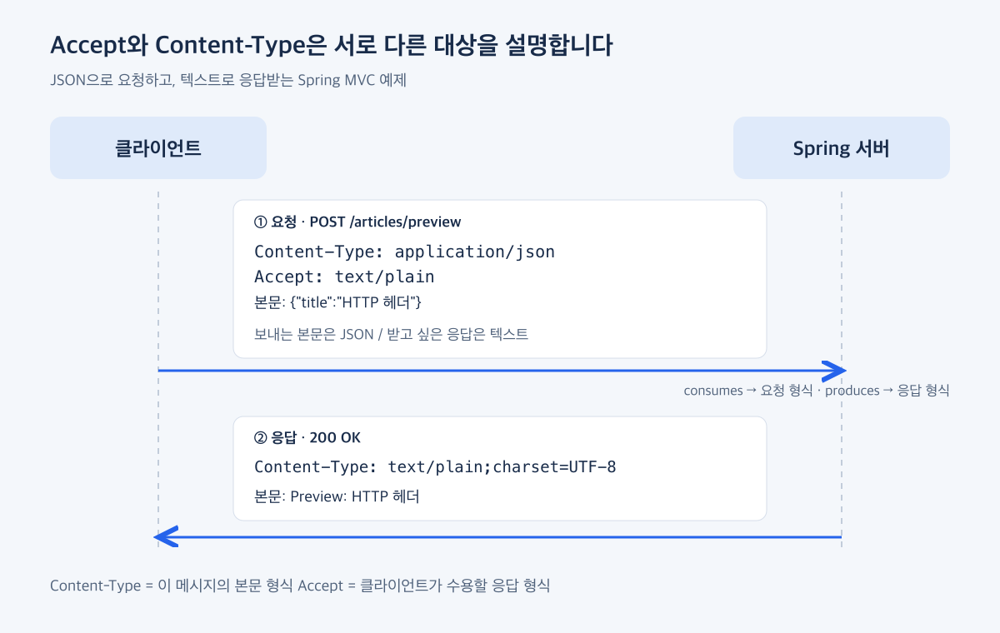

### 표현 선택·해석: 무엇을 보내고 무엇을 받고 싶은가?

첫 번째 역할은 주고받는 데이터의 표현을 선택하고, 본문을 어떻게 해석해야 하는지 알려주는 것입니다. 여기서 표현은 같은 내용을 JSON이나 일반 텍스트처럼 어떤 형식으로 나타내는지를 말합니다.

`Accept`와 `Content-Type`은 모두 `application/json` 같은 값을 사용하지만, 설명하는 대상이 다릅니다.

| 헤더 | 이 예제에서의 의미 |
| --- | --- |
| 요청의 `Content-Type` | 지금 보내는 요청 본문의 형식 |
| 요청의 `Accept` | 클라이언트가 수용할 응답의 형식 |
| 응답의 `Content-Type` | 서버가 실제로 보낸 응답 본문의 형식 |

따라서 JSON으로 요청했다고 반드시 JSON으로 응답받아야 하는 것은 아닙니다. JSON으로 글 제목을 보내고 일반 텍스트로 미리보기를 받는 상황을 생각해 보겠습니다.



```http
POST /articles/preview HTTP/1.1
Host: localhost:8080
Content-Type: application/json
Accept: text/plain

{"title":"HTTP 헤더"}
```

이 요청은 “본문은 JSON으로 보냈고, 응답은 일반 텍스트로 받고 싶다”는 의미입니다. 서버가 이를 지원하면 다음처럼 응답할 수 있습니다.

```http
HTTP/1.1 200 OK
Content-Type: text/plain;charset=UTF-8

Preview: HTTP 헤더
```

요청과 응답의 `Content-Type`이 서로 다르지만 정상적인 흐름입니다. 각각 자신이 속한 메시지의 본문을 설명하기 때문입니다. `charset=UTF-8`은 이 텍스트를 해석할 문자 인코딩을 지정합니다. 메시지는 설명을 위해 일부 헤더를 생략한 HTTP/1.1 예시입니다.

[MDN Accept](https://developer.mozilla.org/en-US/docs/Web/HTTP/Reference/Headers/Accept) · [MDN Content-Type](https://developer.mozilla.org/en-US/docs/Web/HTTP/Reference/Headers/Content-Type)

### Spring에서는 어떻게 표현할까?

DB 저장 없이 받은 제목을 미리보기로 반환하는 API를 만들어 보겠습니다. 아래 Controller는 같은 URL과 HTTP 메서드에서 JSON과 텍스트 응답을 지원합니다.

```java
@RestController
public class PreviewController {
    public record ArticleRequest(String title) {}
    public record ArticlePreview(String title, String message) {}

    @PostMapping(value = "/articles/preview",
            consumes = "application/json", produces = "application/json")
    public ArticlePreview json(@RequestBody ArticleRequest request) {
        return new ArticlePreview(request.title(), "Preview: " + request.title());
    }

    @PostMapping(value = "/articles/preview",
            consumes = "application/json", produces = "text/plain;charset=UTF-8")
    public String text(@RequestBody ArticleRequest request) {
        return "Preview: " + request.title();
    }
}
```

- `consumes`는 요청의 `Content-Type`에 맞춰 처리 가능한 요청을 제한합니다.
- `produces`는 요청의 `Accept`와 비교하여 응답 형식에 맞는 매핑을 선택하는 데 사용됩니다.
- `@RequestBody`를 읽고 반환값을 응답 본문으로 쓰는 실제 변환은 Spring의 HTTP 메시지 컨버터가 담당합니다.

`produces`에 원하는 형식을 적는 것만으로 어떤 객체든 그 형식으로 변환할 수 있는 것은 아닙니다. 반환값을 처리할 컨버터가 필요합니다. 이 예제는 Spring Boot의 웹 기본 설정에서 JSON 변환과 문자열 쓰기를 사용합니다. [Spring 요청 매핑](https://docs.spring.io/spring-framework/reference/web/webmvc/mvc-controller/ann-requestmapping.html)

전체 프로젝트와 실행 방법은 [Spring 예제](../../examples/http-headers-spring/README.md)에 있습니다. 먼저 다음 요청을 보내봅니다.

```bash
curl -i http://localhost:8080/articles/preview \
  -H 'Content-Type: application/json' \
  -H 'Accept: text/plain' \
  --data '{"title":"HTTP 헤더"}'
```

응답에서 `200`, `Content-Type: text/plain;charset=UTF-8`, 본문 `Preview: HTTP 헤더`를 함께 확인합니다.

이번에는 본문과 Content-Type을 유지하고 Accept만 바꿉니다.

```bash
curl -i http://localhost:8080/articles/preview \
  -H 'Content-Type: application/json' \
  -H 'Accept: application/json' \
  --data '{"title":"HTTP 헤더"}'
```

이번에는 다음 JSON 본문과 `Content-Type: application/json`을 확인할 수 있습니다.

```json
{"title":"HTTP 헤더","message":"Preview: HTTP 헤더"}
```

### 형식이 맞지 않으면 어디에서 실패할까?

같은 API에서도 입력과 출력 중 무엇이 맞지 않는지에 따라 결과가 달라집니다.

| 변경할 조건 | 이 예제의 결과 | 확인할 부분 |
| --- | --- | --- |
| 요청 `Content-Type: text/plain`, Accept는 JSON | `415 Unsupported Media Type` | 서버가 요청 본문 형식을 지원하는가? |
| 요청은 정상 JSON, `Accept: application/xml` | `406 Not Acceptable` | 수용 가능한 응답 형식을 서버가 제공하는가? |
| Content-Type과 Accept는 JSON이지만 본문은 `not-json` | `400 Bad Request` | 선언한 형식으로 실제 본문을 읽을 수 있는가? |

이 결과는 위 Spring 매핑과 기본 설정에서의 동작입니다. 모든 서버가 지원하지 않는 Accept에 반드시 같은 정책을 적용한다는 뜻은 아닙니다. 여기서는 명확한 JSON·텍스트 Accept를 사용하며, 복수 형식의 우선순위나 와일드카드 처리는 별도 주제로 남깁니다.

`Accept`는 받고 싶은 응답의 조건이고, `Content-Type`은 실제 보낸 본문의 형식입니다. 두 헤더를 구분하면 JSON을 보냈다는 이유만으로 응답도 JSON이라고 가정하거나, 헤더만 바꿔 놓고 본문까지 변환되었다고 생각하는 실수를 줄일 수 있습니다.

<!-- 편집 메모: 2026-10-24 MockMvc 5개 테스트 통과. 위 HTTP 블록은 설명용이며 curl 실측 로그가 아니다. -->
